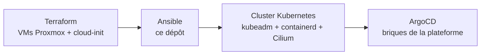

# deploiement-cluster-k8s-ubuntu24

Déploiement **reproductible et idempotent** d'un cluster Kubernetes sur des VMs Ubuntu 24.04, avec Ansible et kubeadm.

Ce dépôt est la couche « configuration » de ma plateforme interne [idp-platform-lab](https://github.com/hocine699/idp-platform-lab) : Terraform crée les VMs sur Proxmox, Ansible les transforme en cluster Kubernetes, puis ArgoCD installe tout le reste depuis Git.



## Ce que fait le playbook

| Rôle | Responsabilité |
|---|---|
| `common` | prérequis système : swap, modules noyau, sysctl, paquets, réglages DNS |
| `containerd` | runtime de conteneurs, configuré pour les cgroups systemd |
| `kubernetes` | kubeadm, kubelet et kubectl, à la version épinglée |
| control plane | `kubeadm init`, kubeconfig, CNI Cilium, taint du control plane |
| `worker` | jonction des workers au cluster |

Cible actuelle : **Kubernetes 1.35**, 1 control plane et 4 workers répartis sur 2 hyperviseurs.

## Choix de conception

| Choix | Pourquoi |
|---|---|
| **Un rôle par responsabilité** | chaque couche se teste, se rejoue et se lit séparément, grâce aux tags |
| **Versions centralisées** dans `inventory/group_vars/all.yml` | une montée de version = une ligne modifiée, visible dans l'historique Git |
| **Idempotence** | rejouer `site.yml` sur un cluster existant ne casse rien et ne change que ce qui doit l'être |
| **Ajout de workers sans toucher au control plane** | `add-workers.yml` avec `--limit` : on agrandit le cluster sans risque pour l'existant |
| **Cilium plutôt que Flannel** | NetworkPolicies, Gateway API et LB-IPAM dans un seul composant, avec eBPF |
| **Control plane réservé** (taint conservé) | les charges applicatives ne concurrencent pas etcd et l'API server |
| **DNS forcé sur le résolveur interne** | la box annonce son propre DNS en IPv6 : sans correction, les nœuds le contournent et résolvent les services internes vers Internet. Le rôle `common` désactive ce DNS annoncé (`ra-overrides: use-dns: false`) |

Le dernier point vient d'une vraie panne : des téléchargements d'images échouaient aléatoirement sur un seul worker. Le diagnostic complet est dans [docs/frictions.md](https://github.com/hocine699/idp-platform-lab/blob/main/docs/frictions.md) du dépôt de la plateforme.

## Utilisation

**Prérequis** : des VMs Ubuntu 24.04 accessibles en SSH par clé, et Ansible sur le poste de travail.

```bash
# 1. Renseigner les machines
vim inventory/inventory.yml

# 2. Vérifier la connectivité
ansible all -m ping

# 3. Déployer le cluster complet
ansible-playbook playbooks/site.yml
```

Opérations courantes :

```bash
# Rejouer une seule couche
ansible-playbook playbooks/site.yml --tags dns

# Ajouter des workers à un cluster existant
ansible-playbook playbooks/add-workers.yml --limit k8s-worker-03,k8s-worker-04

# Monter de version : modifier group_vars/all.yml, puis
ansible-playbook playbooks/upgrade-cluster.yml
```

## Structure

```
.
├── inventory/
│   ├── inventory.yml        # machines et groupes
│   └── group_vars/all.yml   # versions et paramètres globaux
├── playbooks/
│   ├── site.yml             # déploiement complet
│   ├── add-workers.yml      # ajout de nœuds
│   └── upgrade-cluster.yml  # montée de version
└── roles/                   # common, containerd, kubernetes, control plane, worker
```

## Historique

La première version de ce dépôt déployait un cluster de 3 nœuds avec Flannel et une pipeline GitLab CI exécutée sur un NAS. Il a évolué avec la plateforme : passage à Cilium, Kubernetes 1.35, 4 workers sur 2 hyperviseurs, correction du DNS. L'observabilité et les outils de la plateforme ne sont plus installés ici, mais par ArgoCD, depuis le dépôt de la plateforme.

## Licence

MIT
